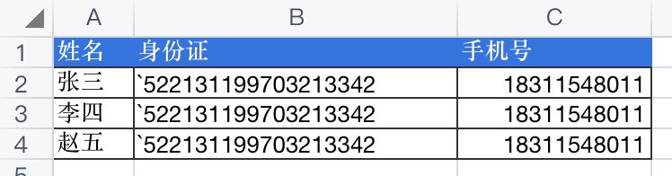

# 简单 Excel 导入导出工具库

🌈 简单使用， 方便快捷。 支持 `xls` `xlsx` `csv` 🌸



## 🎉 使用方法

环境要求
- PHP >= 7.4
- PhpSpreadsheet >= 1.30.3（Composer 会按 PHP 版本自动选择 1.30.x / 2.1.15 / 2.4.4+ / 3.x / 4.x / 5.x）
- **安全建议：PHP 8.3.36+ / 8.4.27+ / 8.5.12+ / 8.2.35+**（已修复 CVE-2026-109618、CVE-2026-109619）

### PHP / PhpSpreadsheet 兼容矩阵

| PHP 版本 | 可用 PhpSpreadsheet 分支 | 说明 |
| --- | --- | --- |
| 7.4 – 8.4 | 1.30.3 – 1.30.7 | 兼容旧项目，仅支持 PHP < 8.5 |
| 8.0 – 8.4 | 2.1.15（2.1.x） | 旧版 2.x 分支，2.2/2.3 已排除 |
| 8.1 – 8.5 | 2.4.4+ / 3.x / 4.x / 5.x | 推荐，PHP 8.5 建议 5.x |
| 8.2.35+ / 8.3.36+ / 8.4.27+ / 8.5.12+ | 以上任意分支 | 已包含两个 CVE 的官方修复 |

安装

```bash
$ composer require yuxiaobo/simple-excel
```

导入

```php
$arr = SimpleExcel::import(dirname(__DIR__) . '/test/test.xlsx', 'xlsx', array(
    '姓名'      => 'name',
    '年龄'      => 'age',
    '性别'      => 'gender'
));
var_dump($arr);
```

不可信上传场景建议限制文件大小、行数、列数，并只读取数据：

```php
$arr = SimpleExcel::import($uploadedFile, 'xlsx', [
    '姓名' => 'name',
    '年龄' => 'age',
], true, [
    'maxFileSize' => 20 * 1024 * 1024, // 20MB
    'maxRows'     => 100000,
    'maxColumns'  => 100,
    'maxCells'    => 5000000,
    'readDataOnly' => true,             // 降低内存占用
    'assertSecureRuntime' => true,      // 确认已升级到 8.3.36+ 再开启；否则会直接拒绝处理
]);
```

> `maxFileSize` / `maxRows` / `maxColumns` / `maxCells` 传 `0` 表示不限制。
> `xls/xlsx` 默认已按 Excel 硬限制兜底（1048576 行、16384 列、10000000 单元格）；`csv` 默认不限制行/列，避免破坏既有用法。
>
> 安全提示：不要直接把用户可控的 `$filePath` 传给本库；请使用上传后的临时文件路径，并在业务层校验文件来源、类型和大小。

导出到文件

```php
SimpleExcel::export('/tmp/dump.xlsx', 'xlsx', [
    'name'      => '姓名',
    'idcard'    => '身份证',
    'mobile'    => '手机号'
], [
    ['name' => '张三', 'idcard' => '522131199703213342', 'mobile'=>'18311548011'],
    ['name' => '李四', 'idcard' => '522131199703213342', 'mobile' => '18311548011'],
    ['name' => '赵五', 'idcard' => '522131199703213342', 'mobile' => '18311548011'],
],'#ff0000', '#00ff00', '#333333');
```

导出并下载数据

```php
SimpleExcel::setDownloadHeader('导出数据.xlsx'); // 设置下载文件响应头
SimpleExcel::export('php://output', 'xlsx', [
    'name'      => '姓名',
    'idcard'    => '身份证',
    'mobile'    => '手机号'
], [
    ['name' => '张三', 'idcard' => '522131199703213342', 'mobile'=>'18311548011'],
    ['name' => '李四', 'idcard' => '522131199703213342', 'mobile' => '18311548011'],
    ['name' => '赵五', 'idcard' => '522131199703213342', 'mobile' => '18311548011'],
],'#ff0000', '#00ff00', '#333333');
```

> 注意：当 `fileName` 为 `php://output` 且导出过程发生异常时，库会自动切换为 `text/html` 并输出友好的错误页面，不再继续下载 xlsx。  
> 如果导出到本地文件路径（如 `/tmp/demo.xlsx`），异常仍会继续抛出。

## 🔐 PHP 8.3.36 与 CVE-2026-109618 / CVE-2026-109619

这两个 CVE 属于 **PHP 解释器本身**，不是本包或 PhpSpreadsheet 的漏洞，无法通过 Composer 升级本包修复。

- `CVE-2026-109618`：OOM 处理路径中的内存破坏（use-after-free），可导致未认证 RCE。
- `CVE-2026-109619`：请求结束后 worker 全局状态未正确重置，后续请求可消费 stale 状态，可导致未认证 RCE。

官方修复版本：**PHP 8.2.35 / 8.3.36 / 8.4.27 / 8.5.12**。升级后必须重启所有 PHP-FPM / Apache worker。

**完整修复只能升级 PHP 运行时。** 本包在代码层做了以下降低触发概率的加固：

1. 新增 `RuntimeSecurity`，可检测当前 PHP 是否受影响，并给出对应分支的修复版本与官方缓解措施。
2. `import()` 支持文件大小、行数、列数、单元格数限制；`xls/xlsx` 默认按 Excel 硬限制兜底（并限制 10000000 单元格，防止稀疏大坐标文件拖垮进程）。
3. 解析器异常统一收敛为 `RuntimeException`，并在 `finally` 中释放 Spreadsheet 资源，减少 OOM / 未捕获 fatal error 路径。
4. CSV 统一使用 RFC 4180（`escape=''`），不再触发 PHP 8.4+ 对非空 `$escape` 的 deprecation，避免产生可被 CVE-2026-109619 利用的 warning/deprecation 状态。
5. 下载响应头、输出缓冲区、错误页均做了 warning/异常收敛。

巡检与 fail-closed 示例：

```php
use yuxiaobo\library\RuntimeSecurity;

$status = RuntimeSecurity::status();
if ($status['affected']) {
    // 记录告警，推动运维升级 PHP
    error_log($status['message']);
    // 可选：不可信上传入口直接拒绝
    // RuntimeSecurity::assertSecure();
}

// 查看官方缓解措施
print_r($status['mitigations']);
```

> 也可以用 `SimpleExcel::import(..., ['assertSecureRuntime' => true])` 在单次导入时 fail-closed。
>
> 注意：`assertSecureRuntime` 会导致受影响的 PHP 直接无法导入，请先评估升级窗口，不要在全部流量上贸然开启。
>
> 更多细节与漏洞报告方式见 [SECURITY.md](SECURITY.md)。

## 🧩 CSV 转义说明（BC 变更）

从 `dev-main` 起，`SimpleExcel::CSV_ESCAPE` 改为空字符串，`fgetcsv` / `fputcsv` 使用 RFC 4180 标准转义：

- 双引号内的逗号、换行、双引号（`""`）均可正确往返；
- 不再使用 PHP 私有的反斜杠转义；
- 在 PHP 7.4 – 8.5 行为一致，且不会触发 PHP 8.4+ deprecation。

如果历史 CSV 依赖 `\"` 这种反斜杠转义，请优先转换数据；确需兼容时可在第 5 个参数（导入）或第 8 个参数（导出）中设置 `csvEscape`：

```php
SimpleExcel::import($file, 'csv', $map, true, ['csvEscape' => '\\']);
SimpleExcel::export($file, 'csv', $header, $rows, '#333333', '#99bcac', '#333333', ['csvEscape' => '\\']);
```

> 注意：PHP 8.4+ 仍会对非空 `$escape` 发出 deprecation，建议只作为临时迁移手段。

性能测试

1. 此库的 `xls/xlsx` 基于的 `PhpSpreadsheet` 实现，且导出表格有着色处理。建议5w行100列以内的数据处理
2. CSV单独做了优化处理, 100000行100列导入导出测试结果如下
    - export: `0.9 sec, 1.6 gb`
    - import: `3.92 sec, 1.6gb`

默认单元测试会跳过上述压测用例，如需执行可使用：`./vendor/bin/phpunit -c phpunit.xml --group performance`

## ✅️ 常见问题

**1. 导入或导出几十万条数据失败**

- ① 游标分批查询数据导出
- ② 数据量较大建议做成异步队列，避免影响主业务
- ③ 少用模型，多用大 DB 查数据（以 thinkphp为例）能明显优化内存与任务耗时
- ④ 只查询需要的字段
- ⑤ 耗时任务强烈建议做成异步队列的方式！！！不要犟，避免影响主业务

**2. 内存超出使用限制**

`Allowed memory size of 8388608 bytes exhausted (tried to allocate 1298358 bytes)`

上述问题是由于内存不足导致的，可能是有死循环，或者代码对内存的使用量比较大。


临时解决办法：`ini_set('memory_limit', '256M');`


**3. 请求超时**

临时解决：`ini_set('max_execution_time', 600);`

> Tips: 也需要注意一下 nginx 的最大保持 http 请求时间


其他优化办法:

- (1). 可以临时通过增加 php 执行时间解决 `ini_set('max_execution_time', 600);`
- (2). 忘记说了，也需要对应增加 nginx/apache 的 http 请求保持时间，它在你的上层～
- (3). 耗时任务强烈建议做成异步队列的方式！！！不要犟，避免影响主业务

**4. 数字太长变成 E+**

~~导出时在前面加个单元号或者反单元号，如身份证：`522131199703253412` 改成 `'522131199703253412`~~

> `0.1.3起` 导出单元格数据强制转换字符串，避免出现科学计算法

**5. 大数据导出**

> 建议: 使用 csv 替代 xlsx，`xls 最大行 65536，xlsx 最大行 1048576（一百万）`, csv 没有限制

- ① 本库的 csv 做过优化，[100 000 rows and 100 columns测试](#性能测试) 基本足够大部分使用场景了
- ② 如果你对内存和速度有更高的追求，我这边有几个推荐。
  - 1. 直接用 php 的 `fputcsv` 和 `fgetcsv`，使用 chunk 分批查询（如果你的框架支持）
  - 2. 使用 PHP 扩展 [xlswriter](https://xlswriter-docs.viest.me/zh-cn) [(感谢 @bugsnail @langziyang @QlanQ 推荐)](https://www.v2ex.com/t/1045263#reply5)
- ③ 导出几百万上千万的数据，怎么打开？用 `UltraEdit` 即可，很🐂🍺的

**6. 空行忽略**

遇到空行数据默认是跳过的

可以通过 simpleExcel::import() 函数的参数4 `ignoreEmptyRow` 设置

**7. 导入遇日期时间为小数问题**

自行通过 `\PhpOffice\PhpSpreadsheet\Shared\Date::excelToDateTimeObject(0.375)->format('Y-m-d H:i:s')` 转换即可;

在 Excel 中，日期时间是一个小数，例如 `09:00:00` 对应的小数为 `0.375`;

- `09:00` 9 = 9/24 = 0.375
- `12:30` (12 + 30/60) = 12.5 = 12.5/24 = 0.5208333333333334

```php
# php简单实现 (备用方案)
function excelTimeToTimeStringSimple(int $excelTime) {
    // Excel的基准日期是1900-01-00，加上天数得到时间戳
    // 86400 = 24 * 60 * 60 (一天的秒数)
    $timestamp = $excelTime * 86400;
    return gmdate("H:i:s", (int)round($timestamp));
}
// excelTimeToTimeStringSimple(0.375) => 09:00:00
```

## 💡意见反馈

如果您在使用过程中遇到了问题，请先反馈 issue

着急使用的话请联系 绿泡泡：Base1024

或是 `fork` 一份自己改，项目遵循 MIT 开源协议

请务必反馈 issue
